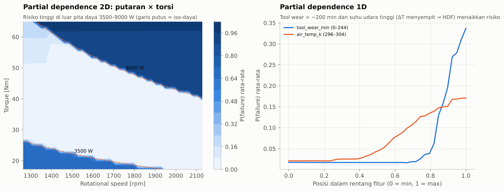
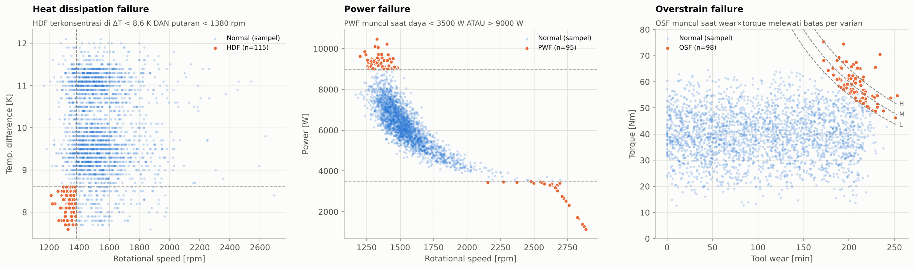
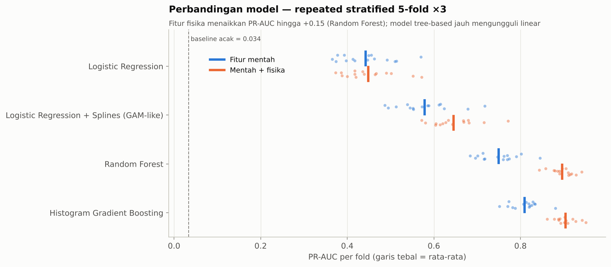
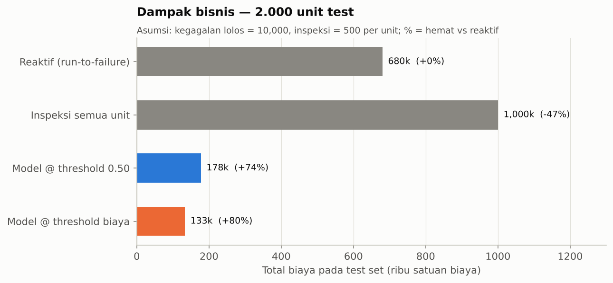
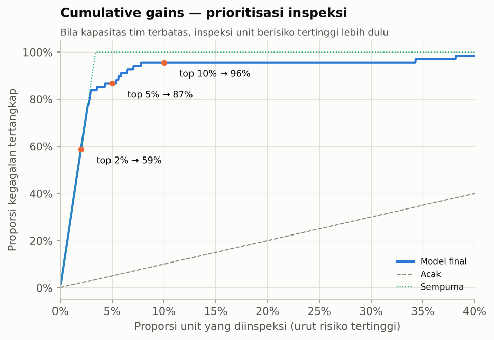
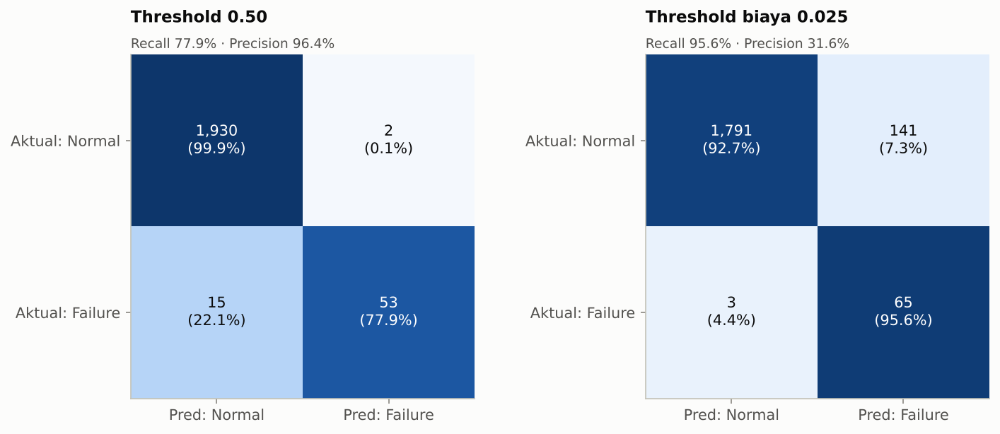
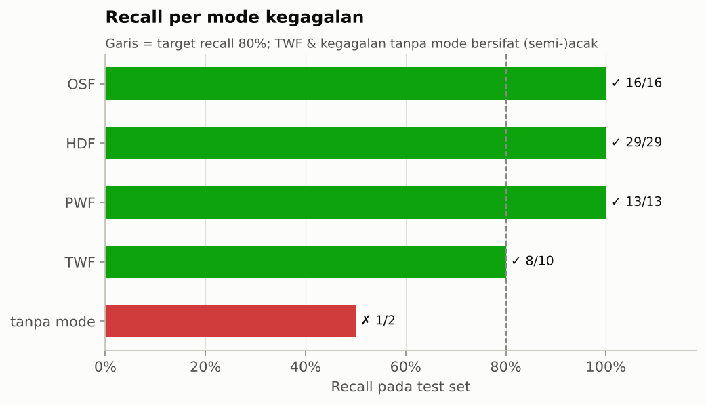
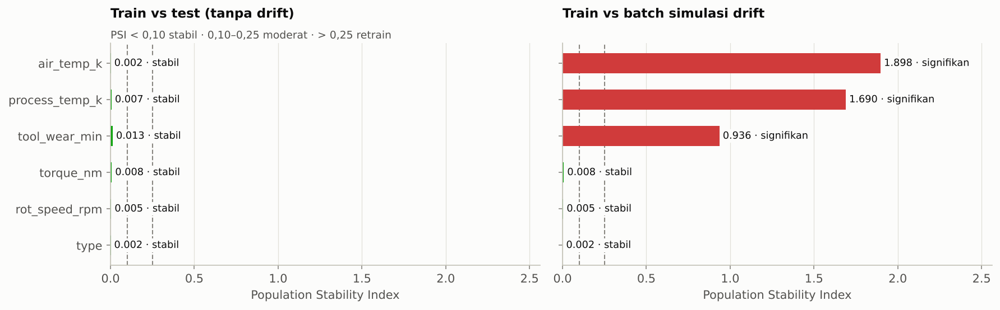

# Machine Failure Prediction — Predictive Maintenance

> Pipeline machine learning end-to-end mengikuti **CRISP-DM** untuk memprediksi kegagalan
> mesin milling, meminimalkan biaya maintenance, dan mendiagnosis **mode kegagalan** —
> dari EDA berbasis fisika sampai REST API dan monitoring drift.

  

## Hasil utama (test set terkunci, 2.000 unit, 68 kegagalan)

| Metrik | Nilai | 95% bootstrap CI |
|---|---|---|
| **PR-AUC** (metrik utama) | **0,906** | 0,839 – 0,960 |
| ROC-AUC | 0,979 | 0,955 – 0,997 |
| Recall @ threshold biaya | **95,6%** (65/68) | 89,7% – 100% |
| Precision @ threshold biaya | 31,6% | 28,2% – 35,4% |
| Penghematan biaya vs reaktif | **80%** (133k vs 680k) | — |
| Inspeksi top-5% unit berisiko | menangkap **87%** kegagalan (lift 17×) | — |

* **Domain knowledge menang:** fitur fisika (daya, strain, selisih suhu) menaikkan PR-AUC
  Random Forest dari 0,75 → 0,90 (+0,15, p < 0,001 — corrected resampled t-test).
* **Model dapat dijelaskan:** surrogate tree (fidelity 98%) menemukan kembali batas fisika
  mesin — daya < 3.550 W / > 8.900 W, strain > 11.000 min·Nm — tanpa diberi tahu.
* **Level risiko tervalidasi:** unit HIGH 96% benar-benar gagal; unit LOW hanya 0,2%.

<p align="center"></p>

## Struktur proyek

```
machine-failure-prediction/
├── configs/config.yaml            # seed, biaya bisnis, ruang hyperparameter — satu sumber kebenaran
├── data/raw/                      # dataset AI4I 2020 (10.000 baris)
├── docs/
│   ├── 01_business_understanding.md   # CRISP-DM tahap 1
│   └── model_card.md                  # dokumentasi model (performa, batasan, monitoring)
├── src/mfp/                       # paket Python yang dapat diuji
│   ├── data.py         # loading, kontrak skema, audit kualitas, split
│   ├── features.py     # PhysicsFeatures (sklearn transformer) + preprocessor
│   ├── models.py       # model zoo + ruang pencarian (XGBoost opsional)
│   ├── evaluation.py   # metrik, bootstrap CI, threshold biaya, Nadeau-Bengio t-test
│   ├── inference.py    # ModelBundle: pipeline + threshold + diagnosis mode + metadata
│   ├── monitoring.py   # Population Stability Index (drift)
│   └── viz.py          # gaya visual konsisten, palet colorblind-safe
├── pipelines/                     # satu skrip per tahap CRISP-DM (2–6)
├── app/
│   ├── api.py          # REST API FastAPI (/predict, /predict/batch, /health, /model-info)
│   └── predict_cli.py  # batch scoring CSV + laporan drift
├── notebooks/machine_failure_prediction.ipynb   # laporan naratif ber-output
├── reports/figures, reports/tables              # semua hasil, dihasilkan otomatis
├── tests/                         # 26 unit test (data, fitur, metrik, inference, API)
├── Makefile, Dockerfile, requirements.txt, pyproject.toml
```

## Cara menjalankan

```bash
python -m venv .venv && source .venv/bin/activate      # Windows: .venv\Scripts\activate
pip install -r requirements.txt

make all        # tahap 2–6: EDA → preparation → modeling → evaluation → deployment (~15 menit)
make test       # unit test
make serve      # REST API di http://localhost:8000/docs
make predict    # batch scoring seluruh dataset + laporan drift
python notebooks/_build_notebook.py   # bangun ulang notebook ber-output
```

Tanpa `make` (mis. Windows): jalankan `python pipelines/02_data_understanding.py`, lalu `03`, `04`, `05`, `06` berurutan.
`python pipelines/04_modeling.py --fast` untuk iterasi cepat (~4 menit).

**Contoh request API**
```bash
curl -X POST localhost:8000/predict -H "Content-Type: application/json" \
  -d '{"type":"L","air_temp_k":300.5,"process_temp_k":310.5,"rot_speed_rpm":1300,"torque_nm":70,"tool_wear_min":60}'
# {"failure_probability":0.9988,"predicted_failure":true,"risk_level":"HIGH",
#  "likely_failure_mode":"PWF","recommended_action":"Inspeksi segera / ...", ...}
```

**Docker**: `make all` lalu `docker build -t mfp-api . && docker run -p 8000:8000 mfp-api`.

## Ringkasan CRISP-DM

### 1. Business Understanding — [`docs/01_business_understanding.md`](docs/01_business_understanding.md)
Kegagalan lolos = 10.000 satuan biaya, setiap alarm/inspeksi = 500. Tujuan: minimalkan total biaya
dengan recall ≥ 80%. Rasio 20:1 → threshold optimal jauh di bawah 0,5. Empat kriteria
*deployment gate* ditetapkan **sebelum** modeling.

### 2. Data Understanding — `pipelines/02_data_understanding.py`
* 10.000 baris, 3,39% gagal (1 : 28,5). Tidak ada missing/duplikat.
* **Label anomali ditemukan:** 9 kegagalan tanpa mode, 18 RNF berlabel tidak gagal.
* Uji Mann-Whitney U + rank-biserial: torsi (r = 0,54) dan putaran (r = −0,53) efek terbesar;
  `type` hanya berasosiasi lemah (Cramér's V = 0,04).
* Mekanisme fisik terkonfirmasi visual: HDF (ΔT < 8,6 K & < 1.380 rpm), PWF (daya di luar
  3.500–9.000 W), OSF (wear × torsi melewati batas per varian), TWF (wear 198–253 min).



### 3. Data Preparation — `pipelines/03_data_preparation.py`
* Kolom **TWF/HDF/PWF/OSF/RNF dibuang dari fitur (target leakage)**; ID dibuang.
* Kontrak skema (rentang fisik) divalidasi saat training **dan** serving.
* Split stratified 80/20 dikunci + manifest (MD5 data, ukuran, failure rate).
* 6 fitur fisika (`temp_diff_k`, `power_w`, `strain_minnm`, `strain_ratio`, `torque_per_krpm`,
  `wear_fraction`) dibuat di dalam `Pipeline` → bebas leakage di setiap fold CV.

### 4. Modeling — `pipelines/04_modeling.py`
| Langkah | Metode |
|---|---|
| Perbandingan | 5 model × 2 set fitur, repeated stratified 5-fold × 3, corrected resampled t-test |
| Tuning | RandomizedSearchCV (25 iterasi, PR-AUC) per model |
| Seleksi | prediksi out-of-fold; ensemble hanya dipakai jika unggul > 0,005 PR-AUC (parsimoni) |
| Kalibrasi | none vs sigmoid vs isotonic (OOF Brier) |
| Threshold | minimisasi biaya pada OOF dengan syarat recall ≥ 80% — **tidak pernah memakai test** |
| Diagnosis | Random Forest multi-label untuk TWF/HDF/PWF/OSF |

| Model (fitur fisika) | CV PR-AUC | Model (fitur mentah) | CV PR-AUC |
|---|---|---|---|
| Hist. Gradient Boosting | 0,904 | Hist. Gradient Boosting | 0,810 |
| Random Forest | 0,897 | Random Forest | 0,750 |
| LogReg + splines | 0,646 | LogReg + splines | 0,578 |
| Logistic Regression | 0,448 | Logistic Regression | 0,442 |
| Dummy (prior) | 0,034 | | |

Setelah tuning, Random Forest (OOF PR-AUC 0,911) terpilih; probabilitasnya sudah terkalibrasi
(Brier 0,0063 — kalibrasi tambahan justru memperburuk), threshold biaya = **0,025**
(konsisten dengan teori Bayes ≈ 0,05).



### 5. Evaluation — `pipelines/05_evaluation.py`
* Test set dipakai **sekali**; bootstrap stratified 1.000× untuk CI.
* Recall per mode: HDF 29/29, PWF 13/13, OSF 16/16, TWF 8/10, tanpa mode 1/2 — kegagalan yang
  lolos adalah yang secara desain acak.
* Explainability: permutation importance, partial dependence 1D/2D, surrogate decision tree
  dalam satuan fisik (`reports/tables/05_surrogate_rules.txt`), SHAP otomatis bila terpasang.
* Diagnosis mode: PR-AUC HDF 0,95, PWF 1,00, OSF 1,00; top-1 diagnosis benar 97%.
* **Deployment gate: 4/4 PASS.**

| | |
|---|---|
|  |  |
|  |  |

### 6. Deployment — `pipelines/06_deployment.py`, `app/`
* `ModelBundle` tunggal (pipeline + threshold + model diagnosis + metadata versi/hash data)
  → yang di-deploy identik dengan yang dievaluasi (smoke test memverifikasi).
* Output: probabilitas, `LOW / MEDIUM / HIGH`, tindakan yang disarankan, dugaan mode.
* REST API FastAPI dengan validasi Pydantic; CLI batch; Dockerfile.
* Monitoring: PSI per fitur terhadap data referensi; simulasi drift (suhu +2,5 K, tool wear
  +40 min) terdeteksi sebagai *signifikan*.



## Keputusan metodologis penting

1. **PR-AUC, bukan accuracy** — model "selalu normal" sudah 96,6% akurat.
2. **Threshold dari biaya bisnis**, dipilih di OOF train, bukan 0,5 dan bukan di test.
3. **Tidak ada SMOTE** — imbalance ditangani lewat `class_weight` (diuji di tuning) +
   threshold; oversampling sintetis cenderung merusak kalibrasi probabilitas.
4. **Uji statistik terkoreksi** saat membandingkan model — selisih kecil tidak diklaim sebagai kemenangan.
5. **Label tidak "dibersihkan"** demi skor — anomali dilaporkan, bukan disembunyikan.

## Keterbatasan & langkah lanjut
* Dataset sintetis berbentuk snapshot → belum ada *remaining useful life*; butuh data deret waktu.
* TWF/RNF secara inheren sulit diprediksi; recall tinggi dibayar dengan inspeksi tool aus (FP).
* Biaya adalah asumsi — ganti dengan biaya nyata dari CMMS perusahaan di `config.yaml`.
* Validasi lewat *shadow deployment* sebelum dipakai mengambil keputusan.

## Catatan XGBoost
`src/mfp/models.py` otomatis menambahkan **XGBoost** ke perbandingan, tuning, dan ensemble
bila paket `xgboost` terpasang (`pip install xgboost`). Hasil pada README ini dihasilkan di
environment tanpa XGBoost; jalankan ulang `make all` setelah instalasi untuk memperbarui
semua tabel dan figur secara otomatis.

## Dataset
S. Matzka, "Explainable Artificial Intelligence for Predictive Maintenance Applications",
*Third International Conference on Artificial Intelligence for Industries (AI4I 2020)*.
Tersedia di UCI Machine Learning Repository dan Kaggle.
